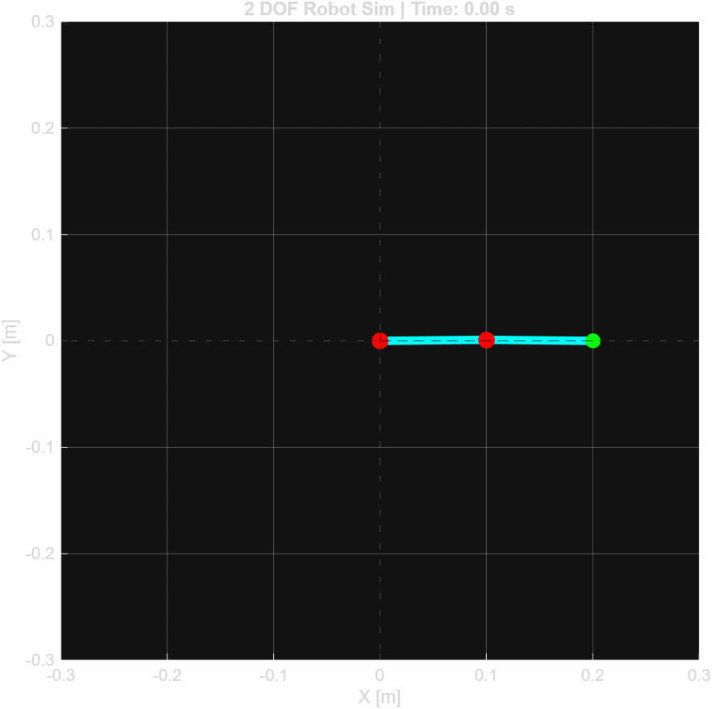

# 2-DOF Planar Robot Manipulator Control Simulation

A MATLAB framework for the dynamic modeling and control of a 2-DOF planar robotic arm. It combines **Lagrangian dynamics**, **Computed Torque Control (CTC)** and **S-curve trajectory planning** to track smooth trajectories with limited jerk.



## Key Features

- **Trajectory planning:** quintic polynomial and double S-curve profiles give continuous acceleration and reduced jerk, which lowers mechanical stress.
- **Physics-based modeling:** the full dynamic model is derived with the Lagrangian formulation, with explicit mass, centripetal/Coriolis and gravity matrices.
- **Nonlinear control:** Computed Torque Control (feedback linearization) for precise trajectory tracking.
- **Inverse kinematics:** geometric solution for the 2-DOF planar arm.

## Method

The manipulator dynamics are

```
M(q) q̈ + C(q, q̇) q̇ + G(q) = τ
```

and the computed torque law applied to a desired trajectory `q_d(t)` is

```
τ = M(q) ( q̈_d + K_d ė + K_p e ) + C(q, q̇) q̇ + G(q),    e = q_d − q
```

where `M` is the inertia matrix, `C` the Coriolis and centrifugal matrix, `G` the gravity vector, and `K_p`, `K_d` are the feedback gains.

## Simulation Results


The graph shows the torques required for the manipulator to follow the planned trajectory under gravity and dynamic effects.

## Project Structure

```
├── src/
│   ├── main.m                    # Entry point: runs the control loop and visualizations
│   ├── Mass_Matrix.m             # Inertia matrix M(q)
│   ├── Centripetal_Matrix.m      # Coriolis and centrifugal terms C(q, q̇)
│   ├── Gravity_Matrix.m          # Gravity vector G(q)
│   └── fifth_order_trajectory.m  # Jerk-limited trajectory profiles
├── robot_simulasyon.gif          # Animation of the simulated motion
└── LICENSE
```

## How to Run

1. Clone the repository:

   ```bash
   git clone https://github.com/giraycevher/2D-Robotic-Arm-Simulation.git
   ```

2. Open MATLAB and set the `src` folder as the current folder.
3. Run `main.m`. The simulation window shows the robot motion and the torque profiles.

## Tech Stack

- **Language:** MATLAB
- **Topics:** robotics, control theory, system dynamics, numerical simulation

## License

Released under the [MIT License](LICENSE).

---

Developed by Giray Cevher Eser.
