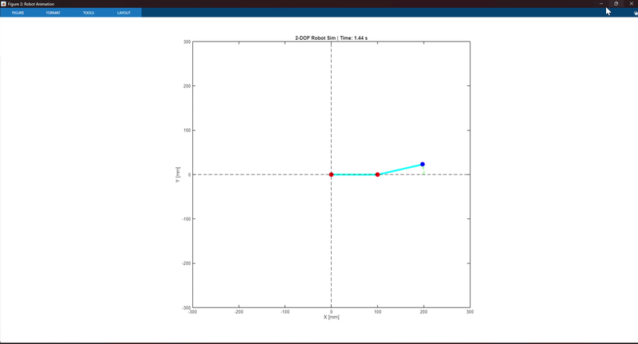

# 2-DOF Planar Robot Manipulator Control Simulation


A MATLAB simulation framework for the dynamic modeling, trajectory planning, and nonlinear control of a 2-DOF planar robotic manipulator. The project implements **Lagrangian mechanics**, **jerk-limited trajectory generation**, and **Computed Torque Control (CTC)** to achieve accurate path tracking under gravitational and inertial coupling effects.

<p align="center">
  
</p>

---

## Key Features

* **Jerk-Limited Trajectory Planning:** Generates smooth joint-space references using quintic (5th-order) polynomials and double S-curve velocity profiles to ensure continuous acceleration and minimize mechanical vibration.
* **Lagrangian Dynamic Modeling:** Explicitly computes the configuration-dependent inertia matrix, Coriolis/centrifugal matrix, and gravity vector without relying on external black-box robotics toolboxes.
* **Computed Torque Control (CTC):** Applies feedback linearization to cancel nonlinear manipulator dynamics, reducing tracking error dynamics to a linear second-order PD system.
* **Geometric Inverse Kinematics:** Analytical inverse kinematics solver mapping Cartesian end-effector coordinates to joint angles $(q_1, q_2)$.

---

## Mathematical Formulation

### Manipulator Dynamics
The equations of motion for the 2-link planar arm derived via the Euler-Lagrange formulation are:

$$M(q)\ddot{q} + C(q, \dot{q})\dot{q} + G(q) = \tau$$

where:
* $q = [q_1, q_2]^T$ is the vector of joint angles,
* $M(q) \in \mathbb{R}^{2\times 2}$ is the symmetric positive-definite inertia matrix,
* $C(q, \dot{q}) \in \mathbb{R}^{2\times 2}$ is the Coriolis and centrifugal matrix,
* $G(q) \in \mathbb{R}^{2}$ is the gravitational torque vector,
* $\tau = [\tau_1, \tau_2]^T$ is the applied joint torque vector.

### Computed Torque Control Law
Given a desired trajectory $q_d(t), \dot{q}_d(t), \ddot{q}_d(t)$, the control torque is computed as:

$$\tau = M(q)\left(\ddot{q}_d + K_d \dot{e} + K_p e\right) + C(q, \dot{q})\dot{q} + G(q)$$

where the tracking error is defined as $e = q_d - q$, and $K_p, K_d \in \mathbb{R}^{2\times 2}$ are diagonal positive-definite proportional and derivative gain matrices. Substituting the control law into the plant dynamics yields the closed-loop error equation:

$$\ddot{e} + K_d \dot{e} + K_p e = 0$$

---

## Simulation Results

### Workspace & Trajectory Path
The end-effector follows the planned semi-circular / multi-arc Cartesian trajectory with continuous velocity and acceleration profiles:

<p align="center">
  
</p>

### Dynamic Torque & Joint Position Analysis
Required actuator torques ($\tau_1, \tau_2$) and joint angle profiles ($q_1, q_2$) over the 20-second trajectory:

<p align="center">
  
</p>

> A high-resolution video recording of the simulation is also available in [`Robot_Arm_Sİm.mp4`](Robot_Arm_S%C4%B0m.mp4).

---

## Project Structure

```text
2D-Robotic-Arm-Simulation/
├── src/
│   ├── main.m                     # Entry point: simulation loop, controller, and animation
│   ├── Mass_Matrix.m              # Computes inertia matrix M(q)
│   ├── Centripetal_Matrix.m       # Computes Coriolis/centrifugal matrix C(q, q_dot)
│   ├── Gravity_Matrix.m           # Computes gravity vector G(q)
│   └── fifth_order_trajectory.m   # Generates quintic / S-curve reference trajectories
├── Dynamics Analysis.png          # Joint torque and position time-history plots
├── Robot Animation.png            # End-effector trajectory path visualization
├── Robot_Arm_Sm.gif               # Simulation animation output
├── Robot_Arm_Sİm.mp4              # High-resolution simulation video
├── LICENSE                        # MIT License
└── README.md
